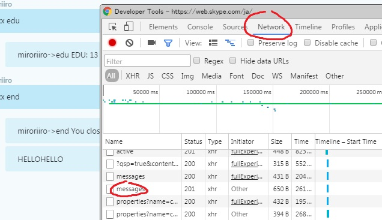
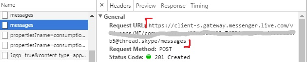
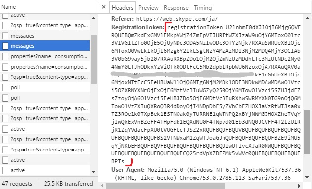

SimpleSkypeBot
===

最小構成の Skype Bot です。

## 概要

`WatchDog` クラスが Skype (クラシック版) のデータベース `main.db` を監視し、更新があると `SimpleSkypeBot` を呼び出します。
`SimpleSkypeBot` クラスは新しい発言の内容を調べ、設定したキーワードを含む発言に対応する返答を Skype for Web の HTTP エンドポイントへ送信します。

キーワードと返答の組み合わせは `SimpleSkypeBot.py` の `PATTERNS` で設定します。

## 現在の状況

- Microsoft の一般向け Skype は 2025 年 5 月 5 日に提供を終了しました ([Microsoft サポート](https://support.microsoft.com/en-us/skype/skype-is-retiring-in-may-2025-what-you-need-to-know))。
  そのため、実際の Skype との接続は現在確認できません。
- このリポジトリで再現・検証できるのは、手元の SQLite データベースと HTTP エンドポイントを使った動作のみです。

## 必要なもの

- Docker (Docker Compose を含みます)

ホストに Python などの言語ランタイムをインストールする必要はありません。

## 設定

設定はすべて環境変数で行います。トークンなどの秘密情報をソースコードやリポジトリに書かないでください。

| 環境変数 | 説明 |
| --- | --- |
| `SKYPE_DB_DIR` | `main.db` があるディレクトリのパスです (コンテナ内のパス)。 |
| `SKYPE_URL` | 返答の送信先 URL です。 |
| `SKYPE_TOKEN` | 送信時に `RegistrationToken` ヘッダーへ付与するトークンです。 |

## 起動方法

`docker compose` の `bot` サービスは、ホストの `SKYPE_HOST_DB_DIR` を読み取り専用で `/skype` にマウントして起動します。

```sh
export SKYPE_HOST_DB_DIR="/path/to/skype/skypeId"
export SKYPE_URL="https://..."
export SKYPE_TOKEN="..."
docker compose up --build bot
```

必要な環境変数が設定されていない場合は、不足している環境変数名を表示して終了します。

## 開発

テストと lint は Docker 上で実行します。

```sh
docker compose run --build --rm dev pytest
docker compose run --build --rm dev ruff check .
docker compose run --build --rm dev ruff format --check .
```

GitHub Actions でも同じコマンドを実行しています。

## 参考: 実 Skype 環境での設定値の取得方法

Skype の提供終了前に使用していた手順です。現在は Skype for Web が利用できないため、この手順は実行できません。

### `SKYPE_DB_DIR` に対応するホスト側のディレクトリ

    Windows - C:/Users/username/AppData/Roaming/Skype/skypeId
    Mac     - /Users/username/Library/Application Support/Skype/skypeId

### `SKYPE_URL`

Chrome で Skype for Web を開き、F12 キーで開発者ツールを開いて Network タブを表示します。
Bot を使用したいチャットで何か発言すると Message という項目が 2 つ表示されますので、画像の赤い印の付いた方を選択します。



Request URL の値を `SKYPE_URL` に設定します。



### `SKYPE_TOKEN`

Request URL から下へスクロールし、`RegistrationToken` の値を `SKYPE_TOKEN` に設定します。


